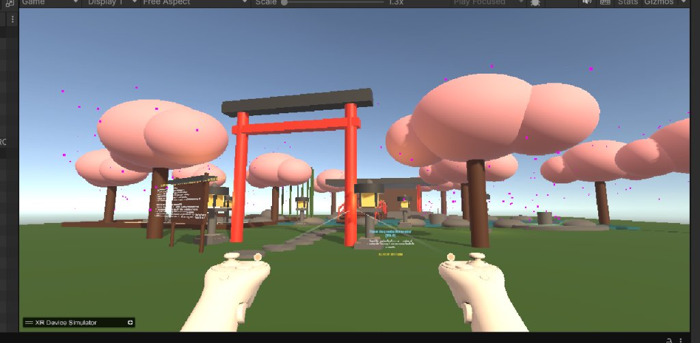
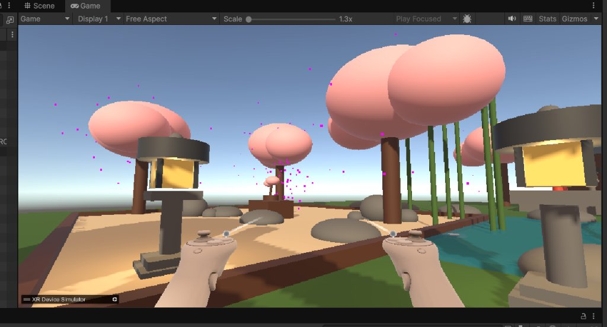
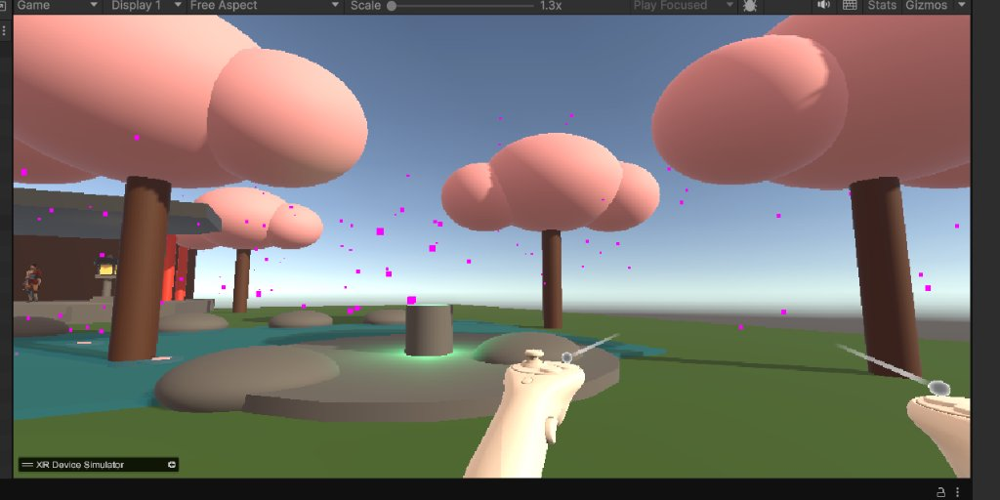
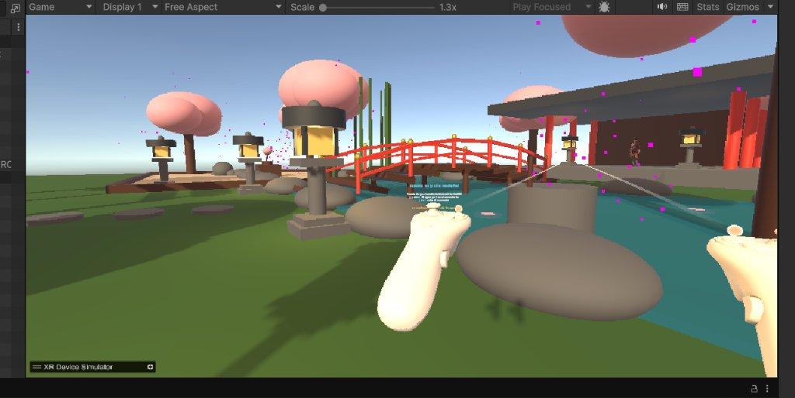
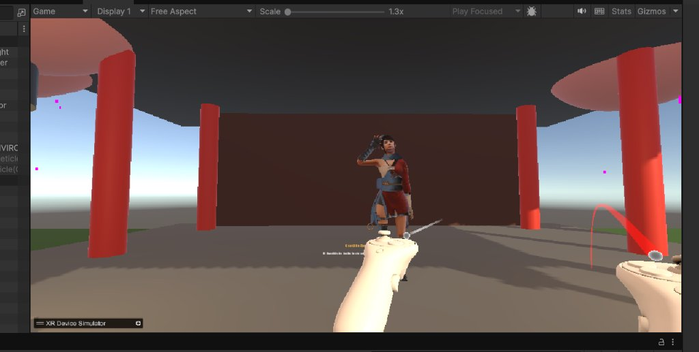
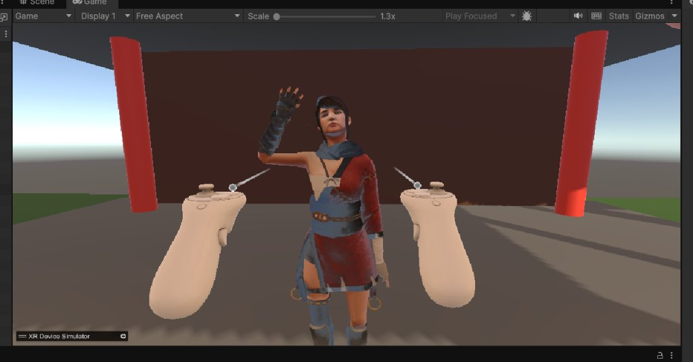

# ZenGardenVR – Spirit of Harmony

An immersive Virtual Reality experience set in a spiritual Japanese Zen Garden, developed with **Unity 6 (6000.6.8f1)**, **Universal Render Pipeline (URP 17.6.0)**, **XR Interaction Toolkit (3.6.1)**, **OpenXR (1.18.0)**, and grounded in academic research on embodied virtual characters and social interaction in VR.

---

## 1. Project Overview

**ZenGardenVR – Spirit of Harmony** transports the player to a serene Japanese shrine landscape where natural tranquility meets ancient spiritual mystery. The environment is composed of 5 distinct contemplative zones:
1. **Torii Gateway Entrance:** Grand vermilion Torii, welcoming stone lanterns (*Tōrō*), stone footpaths, and a traditional wooden information signboard (*Komafuda*).
2. **Karesansui Dry Sand Garden:** Meditation area featuring raked white gravel waves, harmonic rock groupings, and illuminated stone lanterns.
3. **Sacred Altar Circle:** Mystical elevated stone circle featuring a glowing cyan crystal gem resting upon a consecrated pedestal with emerald aura particles.
4. **Scenic River & Arched Bridge:** Flowing crystalline river with floating lotus flowers, interactive bamboo *Tsukubai* fountain, and an authentic arched bridge (*Soribashi*) with golden *Giboshi* finials.
5. **Shinto Sanctuary Hall:** Elevated stone temple foundation with access steps, framing cherry blossoms, and the **Zen Guardian** (*Kachujin G Rosales*), an embodied humanoid virtual character with autonomous social VR interaction.

---

## 2. Photographic Showcase & Zone Breakdown

### Zone 1: Main Entrance & Grand Vermilion Torii

*The pilgrim enters through the sacred Torii gate flanked by blooming Sakura trees, stone path steps, lit stone lanterns, and the physical wooden Welcome Signboard (*Komafuda*) detailing project goals and controls.*

---

### Zone 2: Karesansui Meditation Garden

*Raked sand ripples and contemplative granite rock arrangements framed by glowing Japanese lanterns and bamboo stalks for mindfulness.*

---

### Zone 3: Sacred Altar & Mystical Crystal Gem

*The elevated circular dais where the consecrated Cyan crystal rests upon the central pillar, casting atmospheric lighting and emerald particle auras.*

---

### Zone 4: Scenic River & Traditional Arched Bridge (Soribashi)

*Authentic 11-plank parabolic curved wooden bridge with continuous vermilion railings, Buddhist golden finials (*Giboshi*), river stones, water lilies, and the bamboo Tsukubai water fountain.*

---

### Zone 5: Shinto Sanctuary & The Zen Guardian

*Full perspective of the elevated sanctuary dais with frontal stone access steps, shrine lanterns, and the humanoid Zen Guardian welcoming the visitor.*

---

### Social VR Interaction: Waving & Gaze Tracking

*Close-up of the Zen Guardian (*Kachujin G Rosales*) performing her friendly waving animation (*Waving*), maintaining mutual eye contact (*LookAt / Gaze Tracking*), and responding to user gestures.*

---

## 3. Humanoid Virtual Character & Social Interaction

The virtual character **Zen Guardian** was authored using the Adobe Mixamo character model `Kachujin G Rosales.fbx` and its 6 motion capture performance clips:

### Character Architecture
* **Rig:** Mecanim Humanoid Avatar automatically mapped to standard skeletal hierarchy.
* **Materials:** Universal Render Pipeline (URP) Lit PBR shaders featuring high-resolution Diffuse, Normal bump maps, and Specular maps.
* **State Machine Controller:** `ZenGuardian.controller` managing 6 animation states:
  * `Idle`: Natural cyclic breathing in repose.
  * `Greeting` (*Standing Greeting*): Formal Japanese bow of respect.
  * `Waving`: Friendly raised hand welcoming gesture.
  * `Talking`: Upper-body gesturing and conversational delivery.
  * `Listening` (*Head Nod Yes*): Attentive listening posture with rhythmic affirmative nods.
  * `ExtraNod` (*Sarcastic Head Nod*): Meditative, reflective head movement of patience.

### Human-Like Social Interaction Mechanisms
1. **Proxemics (Distance Awareness):**
   * *Approach Zone (~5.0m):* Guardian detects visitor arrival, chiming sacred bells and performing the Japanese reverence bow (*Standing Greeting*) followed by a hand wave (*Waving*).
   * *Conversational Zone (~3.0m):* Enters active listening mode (*Listening*), ready to converse.
2. **Mutual Gaze Tracking (`ZenGuardianGaze.cs`):**
   * Smooth head orientation tracking the player's HMD camera with anatomical angle constraints (max 65° horizontal, 30° vertical) and quaternion slerp damping, establishing mutual presence without requiring physical eye-tracking hardware.
3. **Head Gesture Detection & Reciprocity (`ZenGuardianInteraction.cs`):**
   * **Affirmative Nod (`Y` key):** Guardian recognizes player assent and nods back with encouragement.
   * **Reflective Shake (`N` key):** Guardian pauses and reflects with calm patience.
   * **Dialogue Delivery (`E` or `Space`):** Advances spoken wisdom regarding Zen philosophy, garden secrets, and spiritual peace.

---

## 4. Hardware Requirements & Performance Specifications

### Supported Platforms
* **VR Headsets:** Meta Quest 2 / Quest 3 / Quest Pro (via Meta Quest Link, AirLink, or SteamVR), HTC Vive, Valve Index, Windows Mixed Reality (OpenXR compliant runtime).
* **Desktop Testing Mode:** Built-in XR Device Simulator fully functional with Mouse and Keyboard.

### System Specifications
| Component | Minimum Specification | Recommended Specification |
|---|---|---|
| **OS** | Windows 10 (64-bit) | Windows 11 (64-bit) |
| **Processor** | Intel Core i5-7500 / AMD Ryzen 5 1600 | Intel Core i7-10700 / AMD Ryzen 7 3700X |
| **Memory** | 8 GB RAM | 16 GB DDR4/DDR5 |
| **Graphics** | NVIDIA GeForce GTX 1060 (6 GB) / AMD Radeon RX 580 | NVIDIA GeForce RTX 3060 / 4060 or higher |
| **DirectX** | Version 11 or 12 | Version 12 |
| **Storage** | 3.5 GB available space | SSD storage recommended |
| **Target Framerate** | 72 fps (VR Comfort Baseline) | 90 fps / 120 fps |

---

## 5. Controls & Interaction Guide

### In VR (Motion Controllers)
* **Locomotion:** Point Ray Interactor with Right Hand at any ground or bridge area and pull the **Trigger** to Teleport instantly.
* **Inspect & Activate:** Aim ray at stone lanterns or fountain and press **Trigger** (Index finger) to toggle light and water flow.
* **Grab Objects:** Squeeze the **Grip** button near the mystical crystal to lift and place it.
* **Talk to Guardian:** Approach the Shinto sanctuary to initiate dialogue; nod or shake your head naturally to converse.

### In Desktop Editor (XR Device Simulator)
* **Walk:** `W`, `A`, `S`, `D` keys.
* **Head Look:** Hold **Right Mouse Button** and drag to rotate the view smoothly.
* **Activate Controller:** Press `Y` (or hold `Space`) to take control of the Right Hand Ray.
* **Trigger / Click:** **Left Mouse Button** to fire ray at lanterns, buttons, or interactables.
* **Grab Object:** Press `G` key (Grip) to grab the magic crystal.
* **Talk / Advance Dialogue:** Press `E` or `Space` when standing near the Guardian.
* **Assent (Nod Yes):** Press `Y` key.
* **Reflect (Nod No):** Press `N` key.
* **Recenter View & Controllers:** Press `V` key to instantly re-center the mouse and hands.
* **Toggle Mission HUD:** Press `M` or `H` key.

---

## 6. Project Architecture & Assets

```text
Assets/
├── Characters/
│   └── ZenGuardian/
│       ├── Models/ZenGuardian.fbx
│       ├── Animations/ (Idle, StandingGreeting, Waving, Talking, HeadNodYes, SarcasticHeadNod)
│       ├── Materials/ (kachujin_MAT, kachujin_MAT_, ZenGuardianKachujin - URP Lit)
│       ├── Textures/ (Kachujin Diffuse, Normal, Specular)
│       ├── Animator/ZenGuardian.controller
│       └── Prefabs/ZenGuardian.prefab
├── Scripts/
│   ├── Character/ (ZenGuardianController, ZenGuardianGaze, ZenGuardianInteraction)
│   ├── Interactions/ (InteractiveLantern, InteractiveFountain, MagicStone, AltarZone)
│   └── UI/ (VRUIManager)
├── Editor/
│   ├── ZenGardenBuilder.cs (Automated environmental builder)
│   └── ZenGuardianSetup.cs (Mixamo avatar & animation configurator)
└── Scenes/
    └── MainVRScene.unity (Primary production VR experience)
```

---

