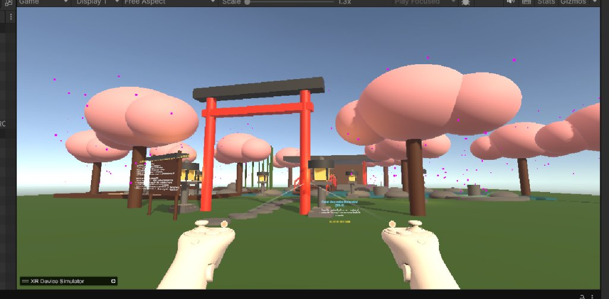
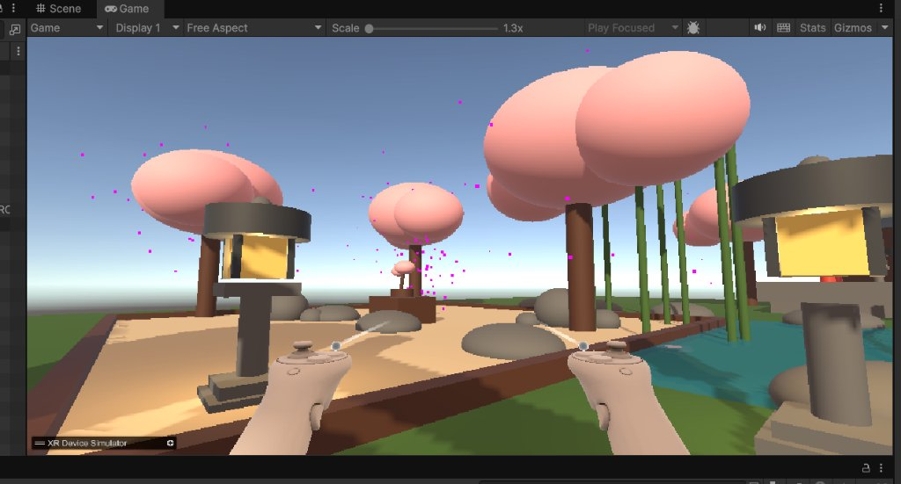
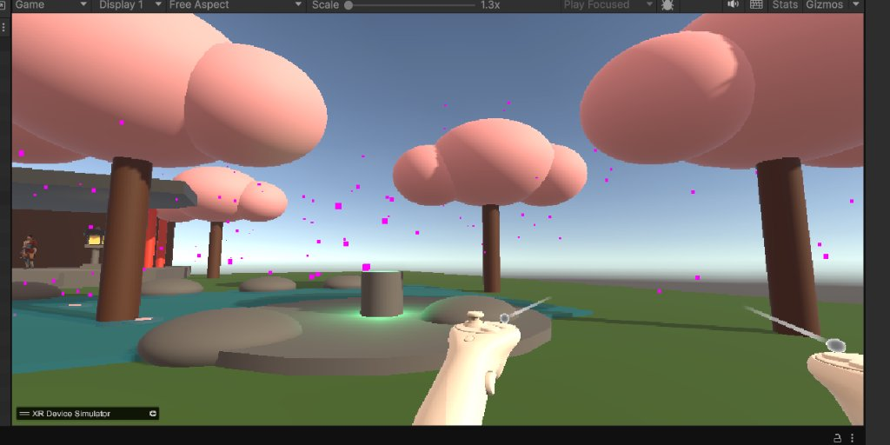
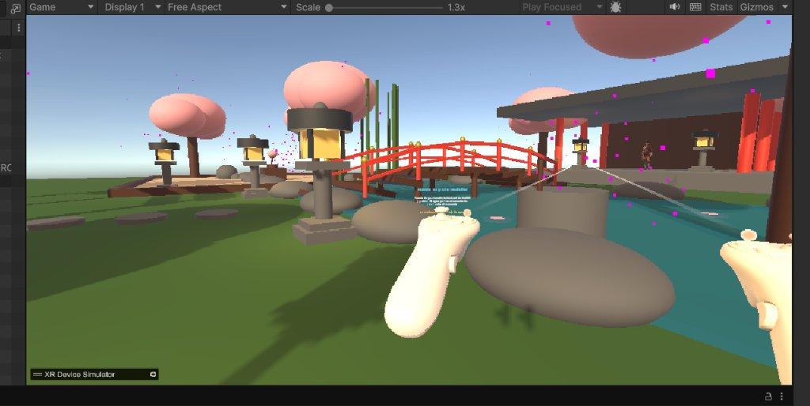
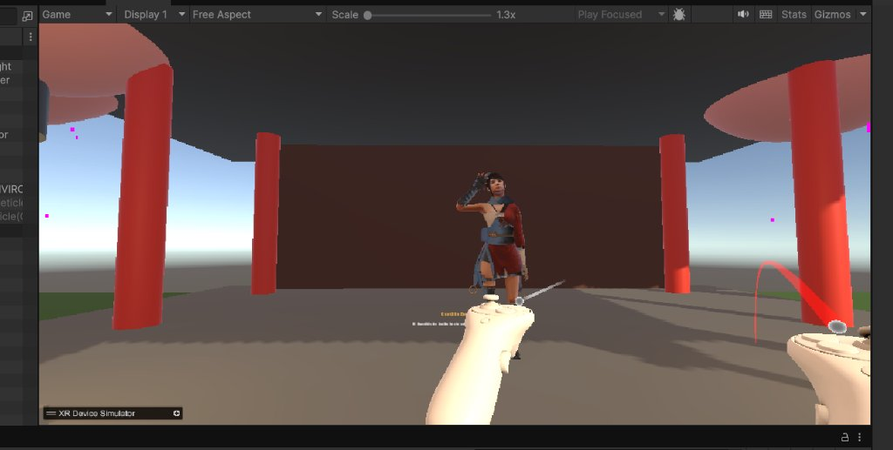
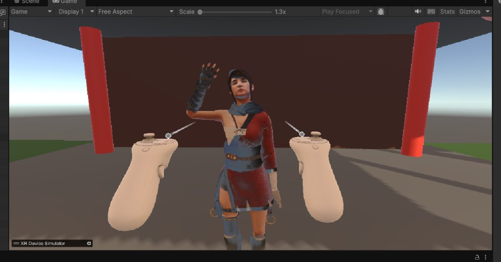

# ZenGardenVR – Spirit of Harmony

Una experiencia inmersiva de Realidad Virtual ambientada en un jardín Zen japonés espiritual, desarrollada con **Unity 6 (6000.6.8f1)**, **Universal Render Pipeline (URP 17.6.0)**, **XR Interaction Toolkit (3.6.1)**, **OpenXR (1.18.0)** y fundamentada en los principios académicos de interacción con personajes virtuales corpóreos en RV.

---

## 1. 🌸 Descripción del Proyecto

**ZenGardenVR – Spirit of Harmony** transporta al usuario a un santuario tradicional japonés donde conviven la paz natural y elementos sagrados espirituales. El entorno está compuesto por 5 zonas contemplativas interconectadas:
1. **Entrada Torii & Cartel de Bienvenida:** Gran Torii bermellón tradicional, senderos de piedra, faroles votivos encendidos y el nuevo tablón físico de madera (*Komafuda*) con la historia y controles.
2. **Jardín de Arena Karesansui:** Zona de meditación con grava blanca rastrillada, grupos de rocas de contemplación, bambúes y faroles de piedra.
3. **Círculo Espiritual & Altar Sagrado:** Estrado circular con la gema de cristal cian consagrada sobre el pedestal, emitiendo luz y partículas de aura esmeralda.
4. **Río Sagrado & Puente Arqueado Tradicional (Soribashi):** Río con flores de loto y nenúfares, fuente de purificación de bambú *Tsukubai*, y un puente de madera arqueado parabólico con pasamanos bermellón continuos y remates budistas dorados (*Giboshi*).
5. **Santuario Shinto & Zen Guardian:** Plataforma elevada de piedra con escalones de acceso, faroles y el **Zen Guardian** (*Kachujin G Rosales*), un personaje virtual humanoide 3D animado con interacción social recíproca.

---

## 2. 📸 Galería Fotográfica de los Escenarios y Pruebas

### Zona 1: Entrada Principal & Gran Torii Bermellón

*Llegada del peregrino ante el Gran Torii, con cerezos en flor Sakura, faroles encendidos y el Tablón Físico de Bienvenida (*Komafuda*) a la izquierda con las misiones del santuario.*

---

### Zona 2: Jardín de Meditación Karesansui

*Arena blanca rastrillada con ondas de agua simbólicas, formaciones rocosas zen y faroles ancestrales de piedra para la contemplación.*

---

### Zona 3: Círculo Espiritual & Altar de la Gema Sagrada

*Estrado ceremonial con la gema mística de cristal cian activada en la cima del pedestal, emitiendo resplandor y partículas esmeralda.*

---

### Zona 4: Río Sagrado & Puente Arqueado Tradicional (Soribashi)

*Puente tradicional japonés con curvatura parabólica de 11 tablones continuos, barandillas bermellón, remates budistas dorados (*Giboshi*), nenúfares y fuente de bambú Tsukubai.*

---

### Zona 5: Santuario Shinto & El Zen Guardian (Vista Completa)

*Perspectiva completa del templo Shinto sobre su estrado de piedra con escalones frontales, faroles y el personaje humanoide Zen Guardian saludando.*

---

### Interacción Social en RV: Saludo con la Mano y Seguimiento de Mirada

*Primer plano del Zen Guardian (*Kachujin G Rosales*) realizando el saludo con la mano (*Waving*), manteniendo contacto visual directo (*Gaze Tracking*) con el usuario.*

---

## 3. 👤 Personaje Virtual Humanoide e Interacción Humana Recíproca

El personaje virtual **Zen Guardian** fue integrado utilizando exclusivamente el modelo base 3D de Adobe Mixamo `Kachujin G Rosales.fbx` y sus 6 clips de animación por captura de movimiento:

### Arquitectura Técnica del Personaje
* **Rig:** Mecanim Humanoid Avatar asignado automáticamente a la jerarquía de huesos.
* **Materiales PBR:** Shaders nativos `Universal Render Pipeline/Lit` con mapas Diffuse, Normal y Specular de alta definición.
* **Máquina de Estados (`ZenGuardian.controller`):**
  * `Idle`: Respiración y postura en reposo.
  * `Greeting` (*Standing Greeting*): Reverencia tradicional japonesa de respeto.
  * `Waving`: Saludo amistoso con la mano en alto.
  * `Talking`: Gesticulación corporal explicativa durante el diálogo.
  * `Listening` (*Head Nod Yes*): Postura de escucha activa con leves asentimientos rítmicos.
  * `ExtraNod` (*Sarcastic Head Nod*): Movimiento de cabeza pausado y reflexivo de paciencia.

### Respuestas Similares a la Interacción Real Humana
1. **Proxémica (Zonas de Edward T. Hall):**
   * *Zona de Aproximación (~5.0 m):* El Guardián detecta la llegada del visitante, reproduce campanas sagradas y realiza una reverencia tradicional (*Standing Greeting*) seguida de un saludo con la mano (*Waving*).
   * *Zona Conversacional (~3.0 m):* Entra en modo de atención receptiva (*Listening*).
2. **Mirada Mutua (*Mutual Gaze Tracking* con `ZenGuardianGaze.cs`):**
   * Orientación suave de la cabeza hacia la cámara del HMD del jugador con amortiguación de cuaterniones y límites angulares anatómicos realistas (máximo 65° horizontal, 30° vertical), simulando contacto visual natural sin requerir hardware de seguimiento ocular físico.
3. **Reconocimiento y Reciprocidad de Gestos (`ZenGuardianInteraction.cs`):**
   * **Asentimiento afirmativo (Tecla `Y`):** El Guardián asiente con la cabeza en señal de mutua comprensión.
   * **Reflexión / Negación (Tecla `N`):** El Guardián reflexiona con paciencia y serenidad.
   * **Diálogo contextual (Tecla `E` o `Espacio`):** Transmite enseñanzas filosóficas zen y secretos sobre la armonía del jardín.

---

## 4. ⚙️ Requisitos de Hardware y Restricciones del Sistema

### Plataformas y Visores Compatibles
* **Visores de Realidad Virtual:** Meta Quest 2 / Quest 3 / Quest Pro (vía Quest Link, AirLink o SteamVR), HTC Vive, Valve Index, Windows Mixed Reality (con runtime OpenXR activo).
* **Modo de Prueba en Escritorio:** Simulador de hardware XR (*XR Device Simulator*) completamente operativo mediante ratón y teclado.

### Especificaciones Técnicas del Hardware
| Componente | Requisito Mínimo | Requisito Recomendado |
|---|---|---|
| **Sistema Operativo** | Windows 10 (64-bit) | Windows 11 (64-bit) |
| **Procesador (CPU)** | Intel Core i5-7500 / AMD Ryzen 5 1600 | Intel Core i7-10700 / AMD Ryzen 7 3700X |
| **Memoria RAM** | 8 GB RAM | 16 GB DDR4/DDR5 |
| **Tarjeta Gráfica (GPU)** | NVIDIA GeForce GTX 1060 (6 GB) / AMD Radeon RX 580 | NVIDIA GeForce RTX 3060 / 4060 o superior |
| **DirectX** | Versión 11 o 12 | Versión 12 |
| **Almacenamiento** | 3.5 GB de espacio libre | Unidad SSD recomendada |
| **Rendimiento Objetivo** | 72 fps (estabilidad mínima de confort) | 90 fps / 120 fps |

---

## 5. 🎮 Guía de Controles y Manejo en RV

### Con Mandos de Realidad Virtual
* **Locomoción por Teletransporte:** Apunta el rayo de tu mano derecha hacia cualquier punto del suelo o puente y presiona el **Gatillo (*Trigger*)** para desplazarte al instante.
* **Interactuar / Encender Faroles:** Apunta el rayo hacia un farol o fuente y presiona el **Gatillo (*Trigger*)**.
* **Agarrar Objetos:** Presiona el botón de **Agarre (*Grip*)** cerca de la gema mágica.
* **Conversar con el Guardián:** Acércate al santuario para iniciar el diálogo; asiente o niega con la cabeza de forma natural.

### Con el Simulador de Escritorio (Teclado y Ratón)
* **Caminar:** Teclas **`W`**, **`A`**, **`S`**, **`D`**.
* **Mirar alrededor:** Mantener presionado el **Clic Derecho** y mover el ratón.
* **Activar Mando Derecho:** Presionar la tecla **`Y`** (o mantener **`Espacio`**).
* **Clic / Gatillo interactivo:** **Clic Izquierdo** sobre faroles, botones o el suelo.
* **Agarrar la Gema:** Presionar la tecla **`G`** (*Grip*).
* **Avanzar Diálogo:** Presionar **`E`** o **`Espacio`** frente al Guardián.
* **Asentir (Sí):** Presionar la tecla **`Y`** (asentimiento afirmativo).
* **Negar / Reflexionar:** Presionar la tecla **`N`** (asentimiento reflexivo).
* **Recentrar vista y mandos:** Presionar la tecla **`V`** (*Reset / Recenter*).
* **Alternar panel de misiones:** Presionar la tecla **`M`** o **`H`**.

---

## 6. 📁 Estructura del Proyecto

```text
Assets/
├── Characters/
│   └── ZenGuardian/
│       ├── Models/ZenGuardian.fbx
│       ├── Animations/ (Idle, StandingGreeting, Waving, Talking, HeadNodYes, SarcasticHeadNod)
│       ├── Materials/ (kachujin_MAT, kachujin_MAT_, ZenGuardianKachujin - URP Lit)
│       ├── Textures/ (Kachujin Diffuse, Normal, Specular)
│       ├── Animator/ZenGuardian.controller
│       └── Prefabs/ZenGuardian.prefab
├── Scripts/
│   ├── Character/ (ZenGuardianController, ZenGuardianGaze, ZenGuardianInteraction)
│   ├── Interactions/ (InteractiveLantern, InteractiveFountain, MagicStone, AltarZone)
│   └── UI/ (VRUIManager)
├── Editor/
│   ├── ZenGardenBuilder.cs (Constructor procedimental de la escena)
│   └── ZenGuardianSetup.cs (Configurador del modelo y animaciones de Mixamo)
└── Scenes/
    └── MainVRScene.unity (Escena principal de producción en RV)
```

---
